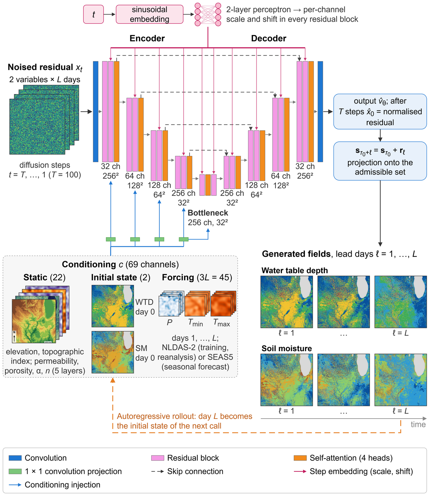
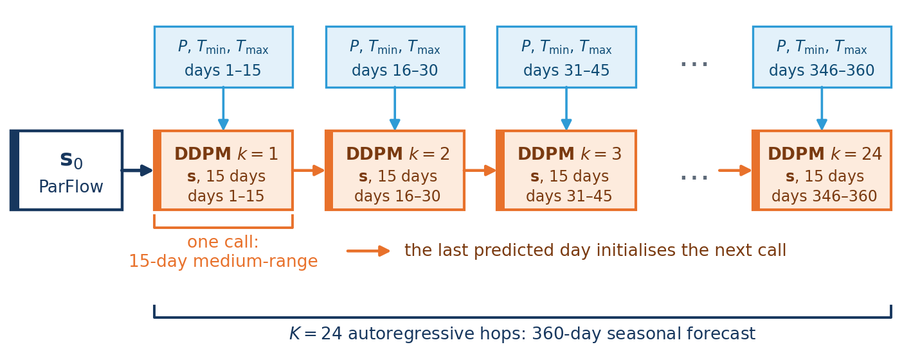
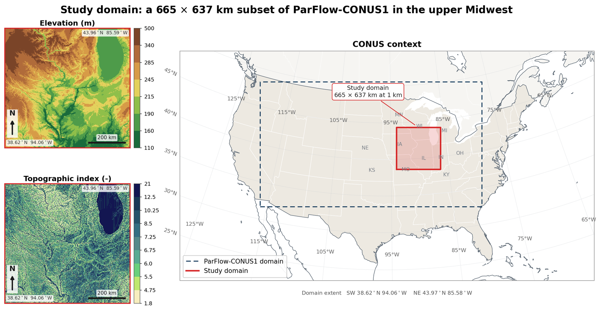

# A conditional diffusion emulator of ParFlow–CLM groundwater dynamics

Code for a conditional denoising diffusion probabilistic model (DDPM) that
emulates the daily **water table depth** and **surface soil moisture** of the
ParFlow–CLM CONUS1 simulation at 1 km resolution, and for its evaluation under
both NLDAS-2 reanalysis forcing and raw ECMWF SEAS5 seasonal forecast forcing.

One call of the model generates 15 days from a single initial state. Chaining
24 calls autoregressively produces a 360-day forecast of a full water year, so
the same model serves medium-range and seasonal forecasting.

This repository contains **source code only**: no data or trained weights are
included (see [Data](#data) for where each input comes from). The three
overview figures below are taken from the accompanying paper.

---

## Overview

### Model architecture



One call of the emulator. The noised residual of water table depth and soil
moisture over *L* = 15 lead days is denoised over *T* = 100 diffusion steps by a
four-level U-Net (32, 64, 128 and 256 channels). The diffusion step enters
through a sinusoidal embedding and a two-layer perceptron, applied as a
per-channel scale and shift in every residual block. The 69 conditioning
channels (static fields, initial state and forcing) are mapped by four 1 × 1
convolution projections and added to the features at each encoder level and at
the bottleneck, which shares the deepest projection. The prediction is added to
the initial state and projected onto the physically admissible range.

### Autoregressive forecasting



A single call gives a 15-day medium-range forecast. Chaining 24 calls, each
initialised from the last predicted day of the previous one and fed the next
15 days of precipitation and minimum and maximum temperature, gives a 360-day
seasonal forecast. Only the first call receives a ParFlow state.

### Study domain



The 637 × 665 km subdomain of the ParFlow–CLM CONUS1 grid in the central US
Midwest, with its elevation and topographic index at 1 km resolution.

---

## At a glance

| | |
|---|---|
| Domain | 637 × 665 cells at 1 km, central Midwest (CONUS1 rows 565–1201, cols 2053–2717) |
| Period | Water years 2003–2006 |
| Target | 2 variables × 15 lead days = 30 channels, predicted as a **residual** from the initial day |
| Conditioning | 69 channels: 22 static + 2 initial state + 3 forcing variables × 15 days |
| Backbone | 4-level U-Net, base width 32, multipliers (1,2,4,8); 9.28 M parameters |
| Diffusion | T = 100 steps, sigmoid ᾱ schedule, **v**-prediction, loss weighted by ᾱₜ |
| Sampling | Ancestral DDPM over all 100 steps — no DDIM or other accelerated sampler |
| Validation | Leave-one-water-year-out, 4 folds, no validation split, fixed 200-epoch budget |
| Hardware | One node of 8 × A100-SXM4 40 GB |

---

## Layout

```
.                                  data acquisition and preparation
├── download_paper_data.py         ParFlow-CONUS1 targets + static fields + NLDAS-2 (via hf_hydrodata)
├── download_seas5_fullyear.py     SEAS5 hindcasts from the Copernicus CDS
├── download_seas5.py              CDS client helpers used by the SEAS5 scripts
├── prepare_tiles.py               raw NetCDF -> 256x256 tiles, 25 % overlap, 12 tiles/day
├── prepare_seas5_domain.py        SEAS5 -> the study domain and its 1 deg frame
├── compute_normalization_stats.py            per-variable stats, training years only
├── compute_residual_normalization_stats.py   per-lead-day residual stats, training years only
├── seas5_forcing.py               SEAS5 forcing arms + the 1 deg <-> 1 km CoarseMap
├── seas5_chained.py, seas5_fullyear_runner.py, verify_fullyear_forcing.py
│                                  assemble and check the spliced 360-day SEAS5 forcing
├── pipeline_fullyear*.sh          end-to-end driver scripts (PBS)
│
├── ddpm_model/                    the model: training, inference, evaluation
│   ├── train.py                   training entry point (accelerate, data-parallel)
│   ├── dataset_groundwater.py     tile dataset, residual normaliser, channel assembly
│   ├── run_annual_rollout.py      single 360-day autoregressive rollout
│   ├── run_ensemble_rollout.py    N-member ensemble rollout, reanalysis forcing
│   ├── run_seas5_rollout.py       ensemble rollout under SEAS5, incl. the spliced water year
│   ├── physical_bounds.py         projection onto the admissible set after every call
│   ├── evaluate_test.py, analyze_*.py, compare_folds*.py   scoring and diagnostics
│   ├── cache_ensemble_scores.py, make_seas5_figures.py     result caches read by paper/scripts
│   ├── fetch_usgs_wells.py, select_*_wells.py              observation-well acquisition
│   ├── config_f15_fold{1..4}.yaml one config per cross-validation fold
│   ├── pipeline_f15_fold{1..4}.sh PBS job: train -> evaluate -> ensemble rollout -> analysis
│   └── denoising_diffusion_pytorch_modified/   vendored, modified diffusion library (MIT)
│
└── paper/scripts/                 every figure and table in the manuscript
    ├── paper_style.py             shared style, colour vocabulary, fold<->year map
    ├── wells_common.py            well loading, screening, datum alignment, NSE/KGE
    ├── fig_*.py                   figures
    ├── table_*.py                 tables
    └── make_submission.py         assembles the LaTeX submission bundle
```

## Pipeline

```
1. download_paper_data.py              ParFlow targets, static fields, NLDAS-2 forcing
   download_seas5_fullyear.py          SEAS5 hindcasts (1 Oct and 1 May initialisations)
2. prepare_tiles.py                    tile the domain: 3 x 4 = 12 tiles of 256 x 256
   prepare_seas5_domain.py             clip and weight SEAS5 to the domain
3. compute_normalization_stats.py      per fold, from that fold's training years only
   compute_residual_normalization_stats.py
4. ddpm_model/train.py --config ...    one model per fold
5. ddpm_model/run_ensemble_rollout.py  reanalysis-forced ensemble (16 sampler draws)
   ddpm_model/run_seas5_rollout.py     seasonal ensemble (10 forcing members x 4 draws)
6. paper/scripts/*.py                  figures, tables, well comparison
```

### Training

```bash
cd ddpm_model
accelerate launch --num_processes 8 train.py \
    --config config_f15_fold1.yaml \
    --name groundwater_f15_200ep_fold1
```

The four fold configs used for the published results are
`config_f15_fold{1,2,3,4}.yaml`; each is byte-identical to the `config.yaml`
saved beside the corresponding trained checkpoint. They differ only in the
held-out year and in the paths to that fold's normalisation statistics. The
fold-to-year map is

| fold | held out | trained on |
|---|---|---|
| 1 | WY2006 | WY2003–2005 |
| 2 | WY2005 | WY2003, 2004, 2006 |
| 3 | WY2004 | WY2003, 2005, 2006 |
| 4 | WY2003 | WY2004–2006 |

Roughly 84–101 s per epoch on 8 GPUs, so about 4.7–5.7 h per fold and 20.5 h for
the whole cross-validation.

### Inference

Both rollout scripts take the fold's config and its trained checkpoint
explicitly. The invocations below are the ones in `pipeline_f15_fold1.sh` and
`pipeline_fullyear_infer.sh`:

```bash
cd ddpm_model
CFG=config_f15_fold1.yaml
CKPT=Results/groundwater_f15_200ep_fold1/checkpoints/final_model.pt

# reanalysis-forced ensemble: 16 sampler draws over the held-out water year
python run_ensemble_rollout.py --config "$CFG" --checkpoint "$CKPT" \
       --out-dir Results/groundwater_f15_200ep_fold1/rollout --n-members 16

# seasonal: the spliced 360-day water year, one forcing member per GPU
python run_seas5_rollout.py --config "$CFG" --checkpoint "$CKPT" \
       --arm Dyear --init 200510 --out-dir Results/seas5/armDyear_fold1 \
       --n-diff 4 --members 0-9 --max-hops 24
```

`--max-hops 24` is required for the full water year: the default is 14, which
covers the 210 days reachable from a single SEAS5 initialisation. `--init` is the
fold's October initialisation (`200510`, `200410`, `200310`, `200210` for folds
1–4). Members already written are skipped, so a job killed by walltime resumes
where it stopped.

A sampler call denoises a batch of four tiles through 100 steps in about 6.25 s,
so one 360-day trajectory costs roughly 8.5 GPU-minutes (~2500 forecast-days per
GPU-hour). A 16-member reanalysis year takes about 17 minutes of wall-clock on
eight GPUs; a 40-member seasonal year about 43 minutes.

The `--arm` flag selects the forcing experiment; `Dyear` is the one used in the
paper — 360 days assembled from the 1 October initialisation with the 1 May
initialisation spliced in from 2 May (each SEAS5 forecast's first valid day is
the day after initialisation).

---

## Data

Nothing in `data/`, `Results/` or `outputs/` is committed. Sources:

| Input | Source |
|---|---|
| ParFlow–CLM CONUS1 water table depth and soil moisture | `conus1_baseline_mod` via HydroData (`hf_hydrodata`) |
| Static subsurface and terrain fields | `conus1_domain` via HydroData |
| NLDAS-2 forcing (tmin, tmax, precipitation) | `NLDAS2` via HydroData, on the CONUS1 1 km grid |
| SEAS5 seasonal hindcasts | Copernicus Climate Data Store, seasonal forecast daily single levels |
| Observation wells | USGS NWIS; Illinois State Water Survey unconfined network |
| Coastlines, borders, lakes (figures only) | Natural Earth 1:50m, via cartopy |

**Credentials.** The CDS download scripts read `CDSAPI_URL` / `CDSAPI_KEY` from
the environment, or `~/.cdsapirc`. `hf_hydrodata` needs its own registration.
No credentials are stored in this repository, and `.gitignore` is set up to keep
it that way.

Data paths in the configs are relative to `ddpm_model/`, where training and
rollouts are launched, and point to `../data/` (`tiles_root`,
`normalization_stats`, `residual_normalization_stats`). The job scripts take
the interpreters from `$PYTHON` and `$ACCELERATE` (defaults `python3` and
`accelerate`); replace `<your_allocation>` in their `#PBS -A` lines with your
own allocation. `paper/scripts/make_submission.py` uses `$TECTONIC` (default
`tectonic`).

---

## Notes on the implementation

Three details are easy to misread from the paper alone, so they are stated here:

* **Conditioning is injected by addition, not concatenation.** At each of the four
  encoder levels and at the bottleneck, a 1 × 1 convolution maps the full 69
  conditioning channels to that level's feature width, the result is resampled by
  nearest-neighbour interpolation and added to the feature map. There are four
  projection convolutions, not five — the bottleneck runs at 256 channels and
  reuses the deepest encoder level's projection. The decoder receives no
  conditioning injection.
* **The diffusion step embedding modulates, not adds.** It is projected to a
  per-channel scale and shift and applied after the norm of the *first*
  convolution block of each residual block (FiLM / adaptive normalisation).
* **Physical bounds are enforced outside the sampler.** Reverse diffusion is left
  unconstrained; water table depth is clamped to ≥ 0 and soil moisture to
  [0, porosity] once per call, inside the rollout loop, for all 15 lead days.

## Attribution

`ddpm_model/denoising_diffusion_pytorch_modified/` is a modified copy of
[lucidrains/denoising-diffusion-pytorch](https://github.com/lucidrains/denoising-diffusion-pytorch)
(MIT, © Phil Wang). Its licence is retained alongside the code, and the upstream
README is kept as `README.upstream.md`. The modifications add conditional
variants — `ConditionalUnet` and `ConditionalGaussianDiffusion` — that take a
separate conditioning tensor and a scalar "physics" embedding.

## Scope

This repository contains the code behind the published results only. The paper
drives the emulator with **raw** SEAS5, with no bias correction of any kind.
Comments in `seas5_forcing.py` and `prepare_seas5_domain.py` still mention
exploratory ERA5, GloFAS and bias-correction strands of the original project;
those code paths are optional, are not used for the published results, and the
scripts that implemented them are not included.

## Installation

```bash
pip install -r requirements.txt
pip install -e ddpm_model/denoising_diffusion_pytorch_modified
```

## Licence and citation

MIT; see `LICENSE`. The vendored diffusion library keeps its own MIT licence.
If you use this code, please cite it using `CITATION.cff` and the accompanying
paper (in review).
